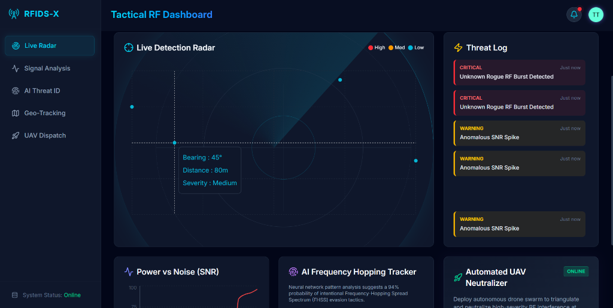
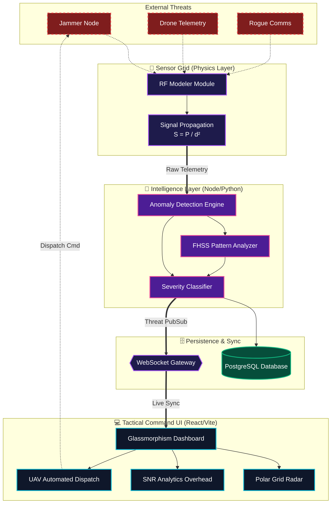

<div align="center">

# 📡 **RFIDS-X : Tactical Interference & Threat Defense**
*AI-Powered Radio Frequency Localization System*

[]()
[]()
[]()
[]()

*"In invisible warfare, visibility is your only weapon."*



</div>

<br />

> **RFIDS-X** is the next-generation, real-time Radio Frequency (RF) telemetry and defense suite. Built to instantly detect, track, and neutralize rogue interference across hostile airspaces, telecom grids, and mission-critical networks. 

---

## ⚡ **Why RFIDS-X Wins**

Standard RF detection is reactive. **RFIDS-X is proactive.** We fused a pristine physics-based signal degradation model (`S = P / d²`) with an aggressive **AI Threat Engine** and a breathtaking, fully-animated tactical frontend.

### 🌟 **Standout Upgrades & Features**
- 🧠 **AI Frequency-Hopping Tracker [NEW]** : Neural pattern analysis seamlessly tracks erratic Frequency-Hopping Spread Spectrum (FHSS) evasion tactics by rogue signals.
- 🚀 **Automated UAV Neutralizer [NEW]** : 1-click autonomous drone swarm dispatch to triangulate and neutralize high-severity Jammers on site.
- 📊 **Dynamic SNR Analytics Overlay [NEW]** : Live power vs. noise-floor charting to prove jammer impact over time without guesswork.
- 🗺️ **360° Tactical Radar** : Immersive polar-grid sonar showing bearing, distance, and threat-classification using real Inverse-Square signal decay.
- 🔴 **Zero-Latency Targeting** : Isolates the dominant signal, flags the severity (`Low`, `Med`, `High`), and logs a forensic threat trail dynamically.

<br />

## 📐 **The Physics Engine**

At the core of RFIDS-X is the **Inverse Square Law** logic layer:

```math
S = \frac{P}{d^2}
```

| Parameter | Function in System |
| :---: | :--- |
| **`S`** | **Signal Strength** penetrating our defense sensor |
| **`P`** | Base **Transmission Power** of the unknown RF anomaly |
| **`d`** | **Distance offset** (used to predict physical origin points) |

Every doubling of distance crushes the jammer's perceived power to a quarter of its strength. Our algorithms use this to precisely estimate the hostile source's location on the radar map.

<br />

## 🏛️ **Architecture & Stack**

Our stack is highly scalable, incredibly fast, and insanely beautiful.

- **🎨 Frontend UI** : React 19, TypeScript, Vite, Tailwind CSS, Radix UI.
- **✨ Motion & Visuals** : Framer Motion (buttery physics-based animations), Recharts (Live Telemetry).
- **⚙️ Simulation Core** : Custom Node.js engine for randomized environment generation and AI rule processing.



<br />

## 🛡️ **Military & Civilian Applications**

1. **Defense / Airspace Management** : Lock onto unauthorized transmissions or jamming attempts that endanger avigation systems.
2. **Telecom / ISP Grid** : Autonomously scan urban spectra for rogue transmitters destroying licensed band throughput.
3. **Event Security** : Protect VIP wireless assets (mics, comms) from targeted Denial of Service RF attacks.

<br />

## 🏁 **Launch the Demo**

> [!TIP]
> **View the Live Experience:** Watch the AI Tracker and UAV dispatch logic run securely inside a simulated RF environment.

🔗 **[ENTER LIVE DEMO DASHBOARD](https://b52ca5d9-6edd-4b77-9b38-2a9c712fcc50.kirk.prod.repl.run/)** *(Web App hosted via Replit)*

*Or run locally:*
```bash
git clone <repo_url>
cd artifacts/mockup-sandbox
npx pnpm install
npx pnpm build && npx pnpm preview
```

---

<div align="center">

🏆 **Hackathon:** CodeClash — DSU (2026) <br/>
🛡️ **Engineered by Team Techno**  

*Detect. Classify. Localize. Neutralize.*

</div>
